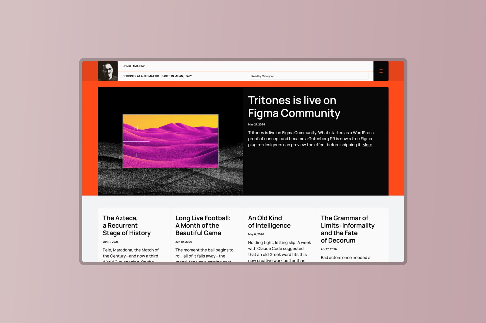
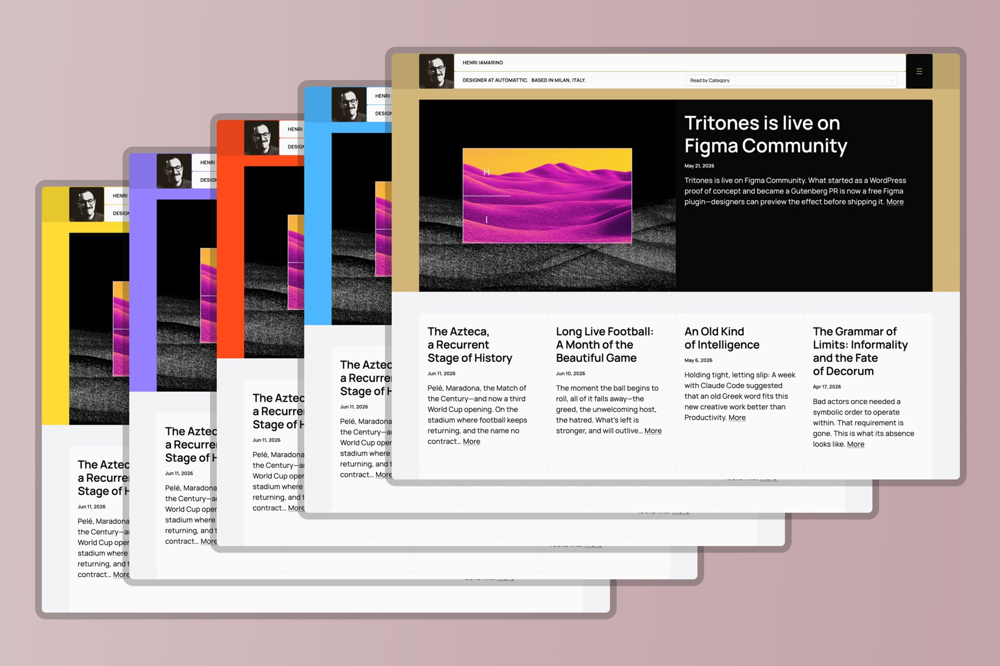
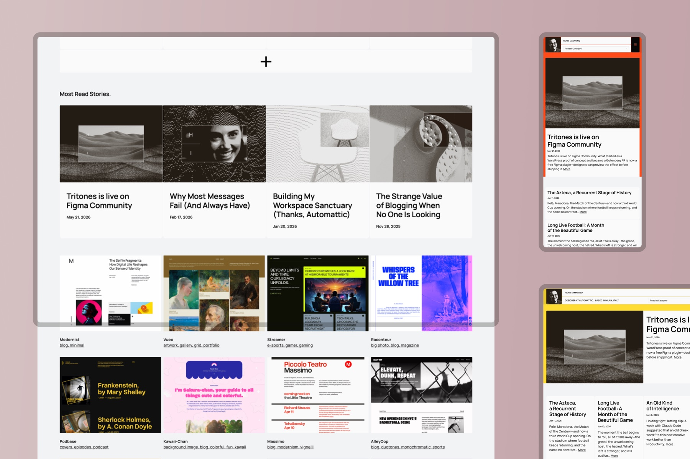
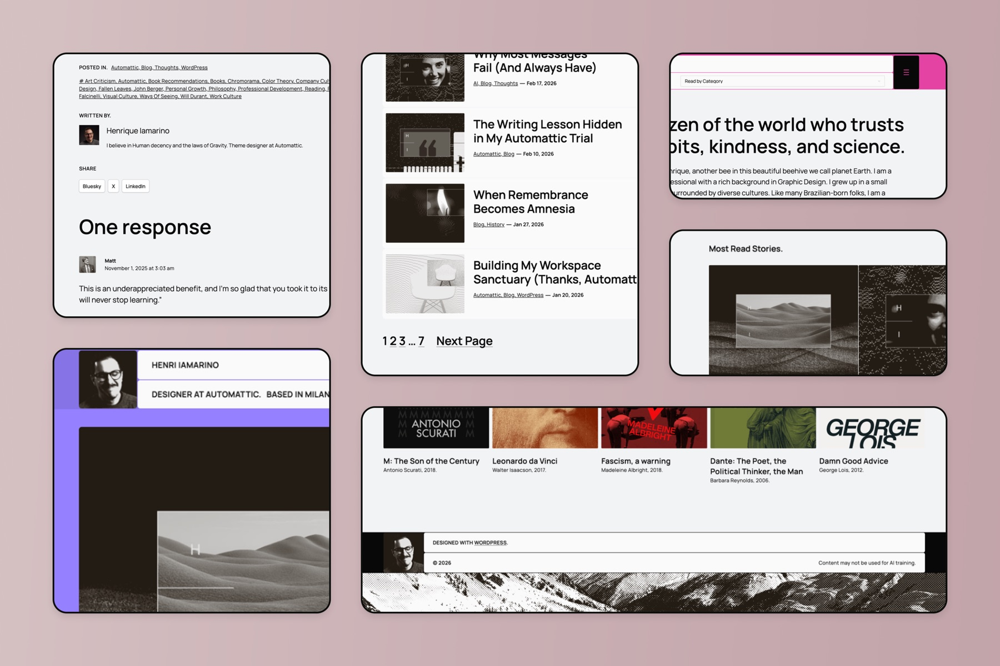
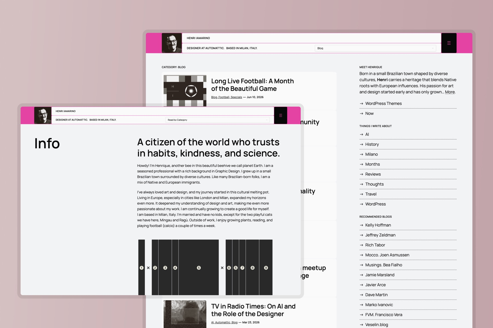
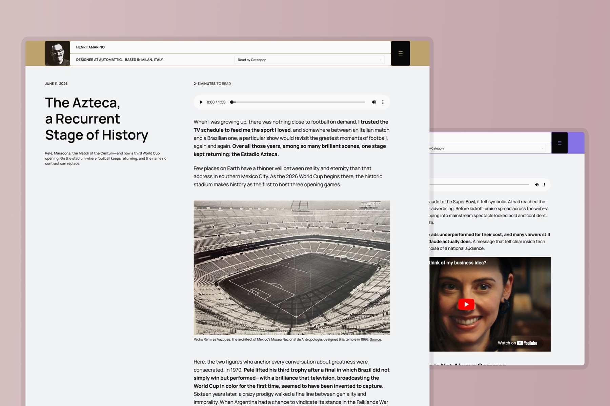

# HI25

**For thoughtful creatives.** The 2025 edition of a yearly series of personal blog themes by Henrique Iamarino, a theme designer at Automattic. A bold editorial header, a full-screen menu with room for a portrait and a few words about you, and eight accent palettes to make it yours.

HI25 is a free WordPress block theme for people who write, read and make things. The header puts your portrait, your name and your categories right up front. The menu opens into a full-screen overlay where readers meet you before they pick a page. Throughout the site, different Query Loop layouts give each kind of writing its own stage, from long essays to book notes to the work you want to show.

→ **See it live:** [hi2025.mystagingwebsite.com](https://hi2025.mystagingwebsite.com/)
→ **Get it:** [GitHub](https://github.com/henriqueiamarino/hi25) · WordPress.org, coming soon

## One theme a year

HI25 is the first edition of a series. Every year I design a theme for my own site, live with it, write with it, and refine it in public. Then I turn it into a free theme for everyone and publish it on WordPress.org. HI25 was designed in 2025 and launched in 2026. The next edition is already on its way.

Each edition keeps a few things from the last and leaves the rest behind, so the series becomes a record of how my work and my writing change from one year to the next.

## Features

- **An editorial header**: Your portrait, the site title, a tagline and a "Read by Category" menu, upfront, to pull readers straight into the writing.
- **A full-screen menu overlay**: The menu at display size, a short introduction, and a portrait with a gentle tilt that comes alive every few seconds. It stays still for readers who prefer reduced motion.
- **Eight accent palettes**: Orange, yellow, pink, blue, golden, purple, green and teal, each one a style variation with its own matching duotone for images.
- **Many Query Loop layouts**: A featured latest post, a row of recent writing and a Most Read section built from your sticky posts.
- **Templates for different kinds of writing**: Book Review and Theme Showcase for posts, and a full-width template for pages.
- **Patterns to start from**: Readings, Readings with Covers and Specials, ready in the block inserter.
- **One typeface, done right**: [Manrope](https://github.com/googlefonts/manrope) under the Open Font License, and nothing else to load.
- **Lightweight & clean**: Styles driven by `theme.json`, no custom JavaScript, no page builders.
- **Built for every screen and every language**: Responsive from the ground up and ready for translation.

## Eight palettes, one character

HI25 keeps its structure in near-black and white and lets one accent color set the mood. Pick a palette under **Appearance → Editor → Styles**: buttons, links, highlights and the duotone on your images all follow it, so the whole site changes character in one click while keeping its bones.

## Meet the reader before the menu

Open the menu and the page gives way to a full-screen overlay: your pages on one side, a few words about you in the middle, and your portrait on the other. It is a small detail that makes a personal site feel personal.

## Patterns to start from

Three patterns wait in the block inserter, ready to drop into any page:

- **Readings**: four book covers in a row, each with its title and author below.
- **Readings with Covers**: the same shelf, with the title and author set on the cover.
- **Specials**: one featured post and a row of four, under a title of your choice.

## Built for any device

Single-column on the phone, multi-column on the desktop, and the editorial feel intact at every width.

## A closer look

| Overview | Reading & topics | Single post |
|:---:|:---:|:---:|
|  |  |  |
| Query Loops, patterns, and parts | Categories and topics, upfront | Optimized for long-form reading |

## Requirements

- WordPress 7.0 or later
- PHP 7.4 or later

## Installation

1. Download the [latest version](https://github.com/henriqueiamarino/hi25/archive/refs/heads/main.zip) (or clone the repository).
2. Copy the `hi25` folder into `wp-content/themes/`.
3. Activate it under **Appearance → Themes**.

You can also install the ZIP directly from **Appearance → Themes → Add New Theme → Upload Theme**. Once HI25 is approved on WordPress.org, you will find it right in your dashboard under **Add New Theme**.

## Credits

- Typeface: **Manrope** by the Manrope Project Authors, under the [SIL Open Font License 1.1](https://openfontlicense.org).
- Marbled papers used as book covers: public domain images from [rawpixel](https://www.rawpixel.com), under CC0.
- Footer and portrait photograph: by the theme author, under CC0.

## License

HI25 is free software, distributed under the **GNU General Public License v2.0 or later**. See [LICENSE](LICENSE) for the full text.

## About the author

I'm Henrique Iamarino, Henri for short, a theme designer building WordPress at Automattic, based in Milan. I write about books, Stoicism, culture and the themes I design at [iamarino.com](https://iamarino.com).
